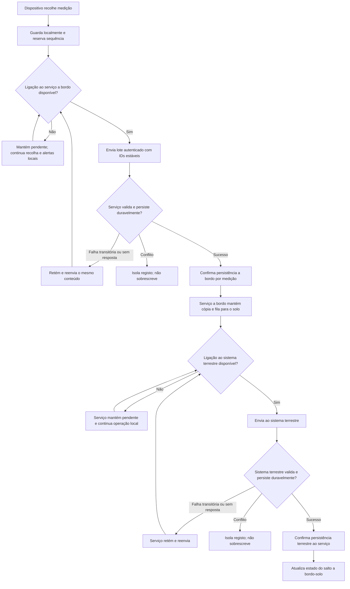

# Arquitetura de dados e sincronização offline

**Estado:** decisão arquitetural para orientar o desenvolvimento
**Âmbito:** fluxo de dados entre dispositivos/PWA, serviço a bordo e sistema
terrestre. Este documento não descreve uma implementação já concluída.

## Contexto e objetivo

A ligação ao sistema terrestre é intermitente. A recolha, a consulta local e os
alertas de monitorização devem continuar a funcionar sem essa ligação. Quando
existe conectividade, os dados pendentes avançam por lotes, sem duplicação e
sem serem removidos da fila do emissor antes de o próximo componente confirmar
a sua persistência durável.

A autoridade dos dados é distribuída por componente e por responsabilidade:
cada componente é responsável pelo que recolhe, calcula ou recebe e persiste.
Isto **não** concede a vários componentes permissão para alterar livremente a
mesma medição. A transferência de custódia, a validação e as correções seguem
regras explícitas e rastreáveis.

## Componentes e responsabilidades

| Componente | Responsabilidade | Autoridade e limites |
|---|---|---|
| Dispositivo/PWA | Recolher medições; atribuir identidade e sequência; guardar localmente; permitir consulta offline; manter e reenviar a fila pendente. | Autoridade sobre a medição de origem e sobre a cópia local até à confirmação durável do serviço a bordo. A fila não pode depender da ligação ao solo. |
| Serviço a bordo | Receber, autenticar e validar pedidos; persistir os dados recebidos; disponibilizar dados e alertas locais; retransmitir dados pendentes ao sistema terrestre; guardar confirmações e conflitos por salto. | Autoridade sobre a cópia recebida e validada, sobre dados derivados produzidos a bordo e sobre o estado de transmissão que mantém. Não altera silenciosamente a medição original. |
| Sistema terrestre | Receber e validar dados; persistir a cópia central; disponibilizar visualização e análise; devolver confirmação de persistência ao serviço a bordo. | Autoridade sobre a cópia terrestre e sobre análises produzidas no solo. Uma cópia terrestre não apaga nem substitui automaticamente cópias a bordo ou na origem. |

As cópias são relacionadas pela identidade estável da medição e mantêm a
proveniência. Uma agregação ou análise é um novo dado derivado, com produtor,
versão da regra e referências às entradas usadas; não substitui as medições.

## Propriedade e identidade dos dados

1. Cada medição recebe um `reading_id` globalmente único na origem e conserva
   esse identificador em todos os saltos.
2. Cada dispositivo tem uma identidade provisionada. Cada medição recebe um
   número de sequência crescente no âmbito desse dispositivo.
3. A sequência é reservada e persistida de forma durável com a medição, antes
   de o dispositivo a considerar guardada. Reinícios, restauros e reinstalações
   não podem fazer a sequência recuar ou reutilizar números. A recuperação da
   identidade de um dispositivo tem de evitar duas instâncias a emitir na mesma
   sequência.
4. Os registos de medição são append-only. Uma correção é um novo evento que
   referencia o registo corrigido, identifica o autor e declara o motivo; não é
   uma atualização destrutiva do original.
5. Os identificadores enviados pelo cliente são metadados de correlação, não
   prova de identidade ou autorização. A identidade do dispositivo e as
   permissões têm de ser autenticadas separadamente.
6. Cada cópia conserva, quando disponível, o instante da medição, a origem, o
   dispositivo, o número de sequência e os instantes de receção e persistência
   em cada componente. A qualidade ou incerteza do relógio deve ser indicada;
   a hora de receção não deve substituir a hora da medição.

## Identidade e autorização: primeira decisão de implementação

Para a primeira etapa do backend, o emissor de identidade é separado da API e
deve estar disponível na rede local da missão. A API valida tokens Bearer JWT
assinados com RS256 usando uma chave pública configurada localmente, sem
depender de uma chamada ao emissor durante cada pedido. Assim, a verificação de
assinatura funciona durante o isolamento da Terra.

O token declara o sujeito (`sub`), emissor (`iss`), público (`aud`), validade
(`iat`/`exp`), tipo de ator (`user` ou `device`), astronautas autorizados
(`astronaut_ids`) e permissões. A API exige escopo por astronauta e permissão
por operação. Para sincronização, o sujeito do token de dispositivo tem de
corresponder ao identificador do dispositivo no lote. A configuração ausente
ou inválida falha fechada. IDs no corpo do pedido nunca substituem a
autenticação.

Este é apenas o contrato de validação da API; o emissor, provisionamento,
registo/login, renovação de credenciais, revogação offline, rotação de chaves,
armazenamento de tokens na PWA e transporte autenticado entre componentes ainda
precisam de desenho e implementação. As permissões assinadas podem ficar
desatualizadas até o token expirar; a validade offline e a resposta a
revogação devem ser definidas e testadas antes de uso operacional. JWT não
substitui TLS nem a autenticação mútua dos serviços.

Os modelos iniciais de missão, identidade e delegação estão em
`backend/app/mission_identity.py`. A configuração relaciona a autoridade
terrestre e as suas chaves confiáveis, a missão, a identidade/chave do serviço
a bordo e as delegações. Valida missão comum, unicidade de IDs, escopos e
permissões máximas, referências de chaves e validade temporal consistente.
Limites como duração máxima da delegação e duração máxima de tokens são campos
obrigatórios, sem valores padrão: os tempos operacionais continuam por decidir.
Estes modelos ainda não persistem identidades, verificam assinaturas de
delegação nem emitem ou validam tokens.

## Fluxos de comunicação



Uma transferência a bordo concluída não significa que a transferência para a
Terra também terminou. Cada salto tem confirmação e estado próprios. O serviço
a bordo continua responsável por tentar a transferência terrestre até receber a
confirmação durável do sistema terrestre.

## Estados de sincronização

O estado é mantido por medição e por salto, não como um único estado ambíguo
para todo o percurso:

| Estado | Significado |
|---|---|
| `LOCAL_DURABLE` | A origem persistiu a medição e a sua identidade/ordem. |
| `PENDING` | Está durável no emissor, mas ainda não foi enviada ou confirmada pelo próximo componente. |
| `IN_FLIGHT` | Está a ser enviada; a ausência de resposta não prova falha nem sucesso. |
| `ACKNOWLEDGED_DURABLE` | O próximo componente confirmou a persistência durável da medição. |
| `RETRY_WAIT` | O envio falhou transitoriamente ou expirou; a medição permanece pendente para repetição. |
| `CONFLICT_ISOLATED` | Existe incompatibilidade de identidade, sequência ou conteúdo; o registo foi isolado e requer resolução explícita. |

Transições normais por salto:

```text
LOCAL_DURABLE -> PENDING -> IN_FLIGHT
IN_FLIGHT -> ACKNOWLEDGED_DURABLE
IN_FLIGHT -> RETRY_WAIT -> IN_FLIGHT
IN_FLIGHT -> CONFLICT_ISOLATED
```

Uma confirmação de um salto não altera retroativamente os estados de outros
saltos. O estado terrestre só passa a confirmado depois da confirmação do
sistema terrestre.

### Recibos de lotes no backend atual

O backend local mantém um recibo durável por `batch_id`, com o dispositivo de
origem, hash do payload validado, instante de receção, estado `persisted` e
confirmações por medição. O recibo e as medições são inseridos na mesma
transação SQLite. Repetir o mesmo lote devolve o recibo original; reutilizar o
`batch_id` com conteúdo diferente dá conflito. O endpoint
`GET /api/v1/sync/batches/{batch_id}` permite ao mesmo dispositivo recuperar o
resultado depois de perder a resposta. Lotes rejeitados não deixam recibos nem
medições parciais. Esta implementação cobre apenas a receção no serviço local;
não implementa estado de retransmissão do serviço a bordo para o sistema
terrestre.

## Política de confirmação

- O emissor persiste a medição e os metadados necessários antes de iniciar o
  envio.
- O receptor valida e persiste o lote atomicamente antes de confirmar quaisquer
  medições desse lote. A confirmação inclui os `reading_id` aceites e o salto a
  que se refere.
- A confirmação significa que o receptor assumiu a custódia da sua cópia; não
  significa que o dado foi revisto clinicamente nem que já chegou à Terra.
- O emissor só retira da fila as medições explicitamente confirmadas para o
  salto seguinte. Até lá, mantém os dados para repetição após timeout,
  desconexão ou reinício.
- Um lote reenviado com as mesmas identidades e conteúdo deve ser idempotente:
  o receptor confirma a cópia já persistida sem criar uma duplicação.
- A garantia de “persistência durável” depende da configuração e do meio de
  armazenamento reais. O contrato de confirmação deve ser verificado perante
  falha de processo, reinício e falha do meio; uma resposta HTTP isolada não é
  evidência suficiente dessa garantia.
- O backend local configura SQLite com chaves estrangeiras e
  `synchronous=FULL` em cada ligação usada. Isto é uma escolha de configuração,
  não prova de sobrevivência a falha física ou garantia de flush do hardware;
  validar no sistema de ficheiros, armazenamento e plataforma finais.

## Falhas e conflitos

| Situação | Comportamento requerido |
|---|---|
| Ligação indisponível, timeout ou resposta perdida | Manter o registo na fila e repetir com o mesmo ID, sequência e conteúdo. Uma resposta perdida pode significar que o receptor já persistiu o lote. |
| Reenvio idêntico já persistido | Não duplicar; devolver confirmação idempotente. |
| Mesmo `reading_id` com conteúdo diferente | Não atualizar nem escolher uma versão silenciosamente; isolar e sinalizar conflito. |
| Mesma identidade de dispositivo/sequência associada a outra medição | Rejeitar ou isolar; não avançar a sequência assumindo perda ou sucesso. |
| Payload inválido ou versão de protocolo incompatível | Não confirmar como persistido; devolver erro explícito e manter ou colocar em quarentena para diagnóstico conforme a classe do erro. |
| Armazenamento cheio ou persistência falhada | Não confirmar; sinalizar a condição ao operador e aplicar a política de capacidade/segurança aprovada. Não descartar medições silenciosamente. |
| Relógio incorreto ou fora de sincronização | Preservar hora declarada, origem e qualidade do relógio; ordenar também por sequência e hora de receção. Não inferir nem substituir silenciosamente o instante da medição. |
| Correção solicitada | Criar registo de correção auditável que referencia o original; não apagar o original nem resolver pela regra “última escrita vence”. |

Os conflitos devem ficar isolados da fila normal, com dados e motivo preservados,
até uma resolução autorizada, auditada e testada. Uma falha de sincronização não
deve interromper recolha nem alertas locais.

## Critérios para considerar esta decisão implementável

Antes de construir a fila offline, especificar e validar:

1. Emissor local da missão, provisionamento de utilizadores/dispositivos,
   permissões offline, expiração e revogação quando não há ligação ao solo.
2. Contrato de payload e versão de protocolo, tamanho de lote, limites de
   armazenamento e política de retenção.
3. Garantias de durabilidade em cada componente, incluindo configuração SQLite
   ou escolha de armazenamento a bordo e comportamento diante de falhas físicas.
4. Recuperação do contador de sequência e da fila após reinício, restauro,
   substituição ou clonagem de dispositivo.
5. Formato de confirmação por medição e por salto; persistência do histórico de
   lotes e tentativas.
6. Política operacional para conflitos, dados inválidos, relógios incertos e
   armazenamento próximo do limite.
7. Testes de falha de rede em cada fase do envio, reinícios antes/depois da
   confirmação, envios repetidos e concorrentes, corrupção e recuperação de
   armazenamento e sincronização entre múltiplos saltos.

Esta decisão não certifica o sistema para uso espacial ou clínico. A utilização
com dados reais requer validação de segurança, privacidade, operação e missão,
incluindo revisão independente proporcional ao risco.
