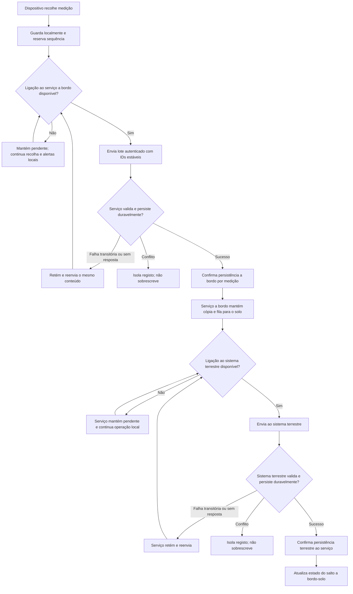

# Arquitetura de dados e sincronização offline

**Estado:** decisão arquitetural parcialmente implementada; ver as limitações
abaixo e a documentação da API para o estado atual
**Âmbito:** fluxo de dados entre dispositivos/PWA, serviço a bordo e sistema
terrestre.

## Contexto e objetivo

A ligação ao sistema terrestre é intermitente. A recolha, a consulta local e os
alertas de monitorização devem continuar a funcionar sem essa ligação. Quando
existe conectividade, os dados pendentes avançam por lotes, sem duplicação e
sem serem removidos da fila do emissor antes de o próximo componente confirmar
a sua persistência durável.

A autoridade dos dados é distribuída por componente e por responsabilidade:
cada componente é responsável pelo que recolhe, calcula ou recebe e persiste.
Isto **não** concede a vários componentes permissão para alterar livremente a
mesma medição. A transferência de custódia, a validação e as correções seguem
regras explícitas e rastreáveis.

## Componentes e responsabilidades

| Componente | Responsabilidade | Autoridade e limites |
|---|---|---|
| Dispositivo/PWA | Recolher medições; atribuir identidade e sequência; guardar localmente; permitir consulta offline; manter e reenviar a fila pendente. | Autoridade sobre a medição de origem e sobre a cópia local até à confirmação durável do serviço a bordo. A fila não pode depender da ligação ao solo. |
| Serviço a bordo | Receber, autenticar e validar pedidos; persistir os dados recebidos; disponibilizar dados e alertas locais; retransmitir dados pendentes ao sistema terrestre; guardar confirmações e conflitos por salto. | Autoridade sobre a cópia recebida e validada, sobre dados derivados produzidos a bordo e sobre o estado de transmissão que mantém. Não altera silenciosamente a medição original. |
| Sistema terrestre | Receber e validar dados; persistir a cópia central; disponibilizar visualização e análise; devolver confirmação de persistência ao serviço a bordo. | Autoridade sobre a cópia terrestre e sobre análises produzidas no solo. Uma cópia terrestre não apaga nem substitui automaticamente cópias a bordo ou na origem. |

As cópias são relacionadas pela identidade estável da medição e mantêm a
proveniência. Uma agregação ou análise é um novo dado derivado, com produtor,
versão da regra e referências às entradas usadas; não substitui as medições.

## Propriedade e identidade dos dados

1. Cada medição recebe um `reading_id` globalmente único na origem e conserva
   esse identificador em todos os saltos.
2. Cada dispositivo tem uma identidade provisionada. Cada medição recebe um
   número de sequência crescente no âmbito desse dispositivo.
3. A sequência é reservada e persistida de forma durável com a medição, antes
   de o dispositivo a considerar guardada. Reinícios, restauros e reinstalações
   não podem fazer a sequência recuar ou reutilizar números. A recuperação da
   identidade de um dispositivo tem de evitar duas instâncias a emitir na mesma
   sequência.
4. Os registos de medição são append-only. Uma correção é um novo evento que
   referencia o registo corrigido, identifica o autor e declara o motivo; não é
   uma atualização destrutiva do original.
5. Os identificadores enviados pelo cliente são metadados de correlação, não
   prova de identidade ou autorização. A identidade do dispositivo e as
   permissões têm de ser autenticadas separadamente.
6. Cada cópia conserva, quando disponível, o instante da medição, a origem, o
   dispositivo, o número de sequência e os instantes de receção e persistência
   em cada componente. A qualidade ou incerteza do relógio deve ser indicada;
   a hora de receção não deve substituir a hora da medição.

## Identidade e autorizacao: estado de implementacao

A confianca da API e configurada localmente por `MISSION_BOOTSTRAP_PATH`, um
caminho absoluto para um ficheiro JSON protegido pelo sistema operativo. O
ficheiro contem a configuracao-base da missao e identidades, as chaves publicas
confiaveis da autoridade terrestre, a chave publica de verificacao do servico a
bordo e delegacoes iniciais assinadas pela Terra. Nao contem chaves privadas.
Em POSIX exige-se propriedade do utilizador do servico e modo `0600`; em Windows
a ACL deve restringir permissao ao proprietario/servico, `SYSTEM`, Administrators
e `OWNER RIGHTS`. Links, reparse points, ficheiros excessivos e ACLs nao
permitidas sao rejeitados.

No arranque, a API valida o bootstrap, inicializa SQLite e instala as delegacoes
iniciais apenas se ainda nao existir provisionamento para a missao. Se existir,
os JWTs guardados sao revalidados com a configuracao-base e as chaves publicas
locais; uma configuracao persistida invalida impede o arranque. A ausencia de
bootstrap mantem endpoints protegidos fechados.

Em cada pedido protegido, a API verifica a assinatura RS256 do token onboard e
confirma emissor/servico, audiencia, `kid`, missao, datas, identidade ativa,
tipo de ator, permissoes e escopos. Os direitos do token tem de ser subconjuntos
da identidade provisionada e estar cobertos por uma delegacao ativa, incluindo
a validade maxima dos tokens. A identidade do dispositivo continua a ser
comparada com o `source_device_id` da sincronizacao. A configuracao e as
delegacoes persistidas sao revalidadas em cada pedido para que alteracoes locais
persistidas nao fiquem escondidas por cache.

Os modelos estao em `backend/app/mission_identity.py`; verificacao de delegacoes
em `backend/app/key_management.py`; bootstrap em
`backend/app/identity_bootstrap.py`; persistencia em
`backend/app/provisioning.py`; e autenticacao da API em `backend/app/auth.py`.
O primeiro conjunto e carregado a partir do bootstrap, mas atualizacoes nao sao
aplicadas automaticamente quando o ficheiro muda. O servico interno de
credenciais em `backend/app/token_service.py` emite tokens de acesso RS256 e
refresh tokens opacos de uso unico; renova por rotacao e revoga localmente a
familia em caso de reutilizacao. O `jti` de acesso e o hash SHA-256 do refresh
sao persistidos, e cada pedido autenticado verifica o estado local de revogacao.
Os endpoints HTTP de autenticacao offline estao implementados em
`POST /api/v1/auth/challenges`, `/api/v1/auth/token`, `/api/v1/auth/refresh` e
`/api/v1/auth/revoke`. O desafio vincula a prova de posse a uma chave publica
previamente provisionada para uma identidade de utilizador ou dispositivo; as
permissoes e escopos emitidos continuam limitados pela identidade e delegacao
validadas. A chave privada onboard e lida de ficheiro protegido em runtime e
nao e guardada no bootstrap nem na base de dados. A autenticacao funcional nao
substitui o provisionamento e a protecao operacional das chaves privadas.

Continuam pendentes um canal/CLI administrativo para atualizar/revogar
delegacoes, gestao segura e rotacao de chaves, politica formal de retencao do
estado de credenciais, protecao contra rollback/adulteracao por administrador
local. O canal de sincronização bordo–Terra tem mTLS próprio, mas isso não
substitui o transporte TLS geral da API nem a configuração de gateway. A emissão de desafios tem um limite móvel por
identidade, configurado explicitamente e persistido em SQLite. Isto não limita
por IP nem protege contra tráfego distribuído entre bases independentes; esses
controlos continuam a exigir gateway e política de missão. JWT nao substitui
TLS nem autenticacao mutua entre componentes. A implementacao nao esta
validada para uso operacional ou dados reais.

## Fluxos de comunicação



Uma transferência a bordo concluída não significa que a transferência para a
Terra também terminou. Cada salto tem confirmação e estado próprios. O serviço
a bordo continua responsável por tentar a transferência terrestre até receber a
confirmação durável do sistema terrestre.

## Estados de sincronização

O estado é mantido por medição e por salto, não como um único estado ambíguo
para todo o percurso:

| Estado | Significado |
|---|---|
| `LOCAL_DURABLE` | A origem persistiu a medição e a sua identidade/ordem. |
| `PENDING` | Está durável no emissor, mas ainda não foi enviada ou confirmada pelo próximo componente. |
| `IN_FLIGHT` | Está a ser enviada; a ausência de resposta não prova falha nem sucesso. |
| `ACKNOWLEDGED_DURABLE` | O próximo componente confirmou a persistência durável da medição. |
| `RETRY_WAIT` | O envio falhou transitoriamente ou expirou; a medição permanece pendente para repetição. |
| `CONFLICT_ISOLATED` | Existe incompatibilidade de identidade, sequência ou conteúdo; o registo foi isolado e requer resolução explícita. |

Transições normais por salto:

```text
LOCAL_DURABLE -> PENDING -> IN_FLIGHT
IN_FLIGHT -> ACKNOWLEDGED_DURABLE
IN_FLIGHT -> RETRY_WAIT -> IN_FLIGHT
IN_FLIGHT -> CONFLICT_ISOLATED
```

Uma confirmação de um salto não altera retroativamente os estados de outros
saltos. O estado terrestre só passa a confirmado depois da confirmação do
sistema terrestre.

### Recibos de lotes no backend atual

O backend local mantém um recibo durável por `batch_id`, com o dispositivo de
origem, hash do payload validado, instante de receção, estado `persisted` e
confirmações por medição. O recibo e as medições são inseridos na mesma
transação SQLite. Repetir o mesmo lote devolve o recibo original; reutilizar o
`batch_id` com conteúdo diferente dá conflito. O endpoint
`GET /api/v1/sync/batches/{batch_id}` permite ao mesmo dispositivo recuperar o
resultado depois de perder a resposta. Lotes rejeitados não deixam recibos nem
medições parciais. Isto cobre apenas a receção dispositivo → serviço local.

### Estado da outbox bordo → Terra

A primeira fase está implementada por `POST /api/v2/sync/readings`; a rota v1
continua local-only. A v2 exige `earth_sync_eligible` explicitamente em cada
medição. O destino `EARTH_SERVICE_ID` só é obrigatório quando há itens elegíveis;
o emissor é derivado da identidade onboard validada. A transação local guarda
medições novas, elegibilidade, recibo inbound, snapshot canónico, hash e itens
em `earth_outbound_batches`/`earth_outbound_batch_items`. A coluna nova tem
default `0`, portanto migração não torna histórico elegível nem cria outbox para
dados antigos. Medições previamente recebidas não são modificadas nem
reenfileiradas.

O estado inicial é `pending`; a resposta declara separadamente
`onboard_status: persisted` e `earth_delivery_status: pending`. Replay do lote
inbound retorna o mesmo `delivery_batch_id`. O hash é apenas controlo de
integridade do conteúdo e não autentica o peer.

O worker one-shot, estado de tentativas/lease, transporte HTTPS/mTLS,
receptor terrestre e recibos JWT autenticados estão implementados. A
configuração mantém parâmetros de timeout, retry e lease explícitos; não há
cadência nem scheduler embutido. `pending` continua a significar apenas que a
obrigação está durável localmente, não que houve transmissão ou receção
terrestre. Os snapshots, rejeições e conflitos permanecem guardados; não há
rotina de descarte.

### Contrato HTTP bordo–Terra, versão 1

O onboard envia um `POST /api/v1/sync/earth/batches` por HTTPS/mTLS. O corpo é
um objeto JSON canónico, ordenado por chave e sem espaços insignificantes, com
campos estritos:

```json
{
  "protocol_version": 1,
  "delivery_batch_id": "UUID",
  "origin_batch_id": "UUID",
  "source_service_id": "identidade onboard",
  "destination_service_id": "identidade Terra",
  "created_at": "instante RFC 3339 com fuso",
  "items": [
    {
      "reading_id": "UUID",
      "astronaut_id": "identificador provisionado",
      "metric": "indicador canónico",
      "value": 72,
      "unit": "bpm",
      "measured_at": "instante RFC 3339 com fuso",
      "received_at": "instante RFC 3339 com fuso",
      "glucose_context": null,
      "declared_origin": "manual",
      "source_device_id": "UUID",
      "sequence_number": 12,
      "origin_batch_id": "UUID"
    }
  ]
}
```

O JWT bearer do onboard é RS256, com `iss`/`sub` iguais à identidade emissora,
`aud` igual ao receptor, `jti`, `iat`, `nbf`, `exp`, `protocol_version`,
`delivery_batch_id` e `payload_sha256`. O receptor exige exatamente estas
claims, confirma a identidade e calcula novamente o hash sobre a representação
canónica. O hash assegura integridade do payload, não autentica o serviço. As
chaves privadas JWT são distintas das chaves TLS.

O sistema terrestre serializa escritores com transação SQLite `BEGIN IMMEDIATE`
e persiste envelope, itens, relações e recibo antes de responder:

| HTTP | Estado do recibo | Significado para a outbox |
|---|---|---|
| `200` | `persisted` ou `already_persisted` | Aceita apenas se recibo assinado confirmar o mesmo lote, hash e conjunto exato de `reading_id`; passa a `acknowledged_durable`. |
| `422` | `rejected_permanent` | Rejeição autenticada e preservada; não repetir automaticamente. |
| `409` | `conflict_isolated` | Conflito autenticado e preservado; não repetir automaticamente. |
| Sem recibo válido, falha de ligação ou erro transitório | — | Não prova sucesso; mantém o lote e agenda retry conforme valores configurados. |

O recibo é JWT RS256 Terra, com emissor/audiência, `jti`, lote, hash,
`recorded_at`, estado, código de resultado e IDs aceites. O receptor grava o
JWT na mesma transação que os dados. Em replay idêntico, devolve o recibo
original; não reescreve medições. Reutilização do ID de lote com outro payload,
conteúdo diferente para um `reading_id`, ou reutilização de sequência por
dispositivo gera conflito sem sobrescrever dados.

O runner `python -m app.earth_receiver` configura TLS com validação obrigatória
de certificado cliente (`CERT_REQUIRED`). O arranque do modo `earth` exige o
runner mTLS e a rota recusa HTTP. O proxy TLS, se usado, tem de validar mTLS e
isolar o serviço de acessos diretos não autenticados. O worker é one-shot:
`python -m app.earth_sync_worker`; o agendador, se necessário, é configurado
pela operação e não tem cadência predefinida pelo código.

### Configuração obrigatória e decisões operacionais

Ambos os serviços requerem `EARTH_SYNC_ROLE`,
`EARTH_SYNC_LOCAL_SERVICE_ID`, `EARTH_SYNC_PEER_SERVICE_ID`,
`EARTH_SYNC_SIGNING_KEY_PATH` e `EARTH_SYNC_PEER_PUBLIC_KEY_PATH`. As
identidades têm de ser distintas; as chaves de assinatura dos serviços também.
O serviço onboard requer `EARTH_SYNC_RECEIVER_URL` (HTTPS e caminho exato),
`EARTH_SYNC_CA_BUNDLE_PATH`, `EARTH_SYNC_CLIENT_CERT_PATH`,
`EARTH_SYNC_CLIENT_KEY_PATH`, `EARTH_SYNC_REQUEST_TIMEOUT_SECONDS`,
`EARTH_SYNC_RETRY_BASE_SECONDS`, `EARTH_SYNC_RETRY_MAX_SECONDS` e
`EARTH_SYNC_LEASE_SECONDS`. O lease tem de exceder o timeout; o máximo de
retry não pode ser inferior à base. O receptor requer
`EARTH_SYNC_BIND_HOST`, `EARTH_SYNC_BIND_PORT`,
`EARTH_SYNC_SERVER_CERT_PATH`, `EARTH_SYNC_SERVER_KEY_PATH` e
`EARTH_SYNC_CLIENT_CA_BUNDLE_PATH`. As chaves privadas e ficheiros de
credenciais são lidos através das verificações de proteção de ficheiros
existentes.

Continuam dependentes de requisitos operacionais: provisionamento e rotação
das identidades, chaves e certificados; CAs confiáveis e revogação; DNS e
topologia/firewall; bind/interface e proxy permitidos; valores aprovados de
timeout, lease e backoff; invocação/scheduler do worker; capacidade, backups,
recuperação e política de retenção; critérios de resolução de conflitos e
rejeições. Nenhum valor operacional ou cadência é escolhido por omissão.
Estas decisões e a durabilidade real da mídia precisam de validação de missão.

## Política de confirmação

- O emissor persiste a medição e os metadados necessários antes de iniciar o
  envio.
- O receptor valida e persiste o lote atomicamente antes de confirmar quaisquer
  medições desse lote. A confirmação inclui os `reading_id` aceites e o salto a
  que se refere.
- A confirmação significa que o receptor assumiu a custódia da sua cópia; não
  significa que o dado foi revisto clinicamente nem que já chegou à Terra.
- O emissor só retira da fila as medições explicitamente confirmadas para o
  salto seguinte. Até lá, mantém os dados para repetição após timeout,
  desconexão ou reinício.
- Um lote reenviado com as mesmas identidades e conteúdo deve ser idempotente:
  o receptor confirma a cópia já persistida sem criar uma duplicação.
- A garantia de “persistência durável” depende da configuração e do meio de
  armazenamento reais. O contrato de confirmação deve ser verificado perante
  falha de processo, reinício e falha do meio; uma resposta HTTP isolada não é
  evidência suficiente dessa garantia.
- O backend local configura SQLite com chaves estrangeiras e
  `synchronous=FULL` em cada ligação usada. Isto é uma escolha de configuração,
  não prova de sobrevivência a falha física ou garantia de flush do hardware;
  validar no sistema de ficheiros, armazenamento e plataforma finais.

## Falhas e conflitos

| Situação | Comportamento requerido |
|---|---|
| Ligação indisponível, timeout ou resposta perdida | Manter o registo na fila e repetir com o mesmo ID, sequência e conteúdo. Uma resposta perdida pode significar que o receptor já persistiu o lote. |
| Reenvio idêntico já persistido | Não duplicar; devolver confirmação idempotente. |
| Mesmo `reading_id` com conteúdo diferente | Não atualizar nem escolher uma versão silenciosamente; isolar e sinalizar conflito. |
| Mesma identidade de dispositivo/sequência associada a outra medição | Rejeitar ou isolar; não avançar a sequência assumindo perda ou sucesso. |
| Payload inválido ou versão de protocolo incompatível | Não confirmar como persistido; devolver erro explícito e manter ou colocar em quarentena para diagnóstico conforme a classe do erro. |
| Armazenamento cheio ou persistência falhada | Não confirmar; sinalizar a condição ao operador e aplicar a política de capacidade/segurança aprovada. Não descartar medições silenciosamente. |
| Relógio incorreto ou fora de sincronização | Preservar hora declarada, origem e qualidade do relógio; ordenar também por sequência e hora de receção. Não inferir nem substituir silenciosamente o instante da medição. |
| Correção solicitada | Criar registo de correção auditável que referencia o original; não apagar o original nem resolver pela regra “última escrita vence”. |

Os conflitos devem ficar isolados da fila normal, com dados e motivo preservados,
até uma resolução autorizada, auditada e testada. Uma falha de sincronização não
deve interromper recolha nem alertas locais.

## Próximas fases antes de considerar esta decisão operacionalmente preparada

O protocolo, a outbox, o worker e o receptor são funcionalidades implementadas,
mas não equivalem a prontidão para missão. Antes de uso operacional, especificar,
aprovar e verificar:

1. Provisionamento/revogação/rotação de identidades, chaves e certificados; CAs,
   identidade do serviço, DNS, firewall, interface de bind e eventual proxy.
2. Timeout, lease, backoff e invocação do worker; manter esses valores alinhados
   com a latência e disponibilidade medidas, sem assumir uma cadência.
3. Capacidade de armazenamento, cópias de segurança, recuperação e retenção.
   Não há eliminação automática de pendências, rejeições ou conflitos.
4. Critérios e responsáveis para resolução de conflitos e rejeições permanentes.
5. Ensaios de reinício, perda de conexão, resposta perdida após commit, falha
   parcial/transacional, concorrência de envios e receções, integridade e
   recuperação de armazenamento no hardware e sistema de ficheiros finais.
6. Validação independente proporcional ao risco, testes de segurança e ensaios
   operacionais representativos; testes automatizados não demonstram por si só
   durabilidade física, segurança completa ou aptidão para missão.

Esta decisão não certifica o sistema para uso espacial ou clínico. A utilização
com dados reais requer validação de segurança, privacidade, operação e missão,
incluindo revisão independente proporcional ao risco.
